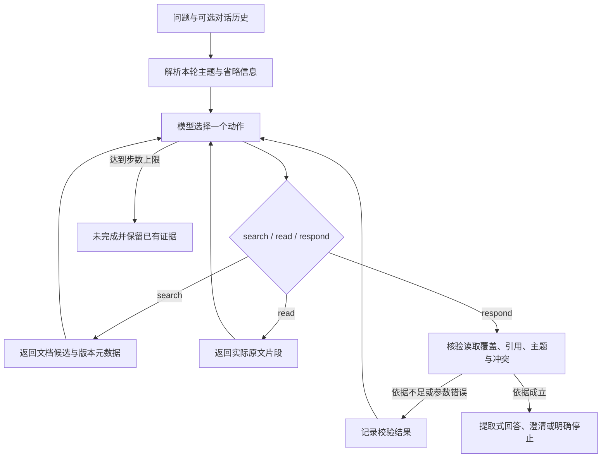

# 调用流程、动态决策与技术取舍

采用 Python 3.12 标准库和 CLI，实现小规模本地知识库的检索、片段读取与真实模型决策循环，不依赖第三方 Agent 框架或向量数据库。受控资料规模较小，直接枚举和关键词检索便于检查命中、改写、覆盖与冲突。模型配置和 HTTP 协议沿用前题已验证的约定，但源码独立放在本目录，不导入其他题目目录。



## 模型和运行时的责任

真实模型每轮接收问题、用户历史主题线索、候选文档、已读片段、工具错误和剩余步数，再选择下一动作。允许的业务工具为 `search_documents` 和 `read_document`；最终动作 `respond` 的参数为：

```json
{
  "kind": "answer|clarify|not_found|tool_failure|stop",
  "evidence": [
    {"doc_id": "D01", "passage_id": "P1", "quote": "实际读取的完整原文片段"}
  ]
}
```

动作外层还记录一句可观察事实构成的简要选择依据。模型决定查询、补查、读取和回答意图；运行时负责参数契约、可引用来源、覆盖检查与最终状态。程序不使用固定分支预先伪造模型动作，也不把隐藏思维过程作为运行日志。离线 Mock 是独立、明确标识的确定性测试入口。

## 检索改写与上下文补全

第一轮可以使用原问句检索。问法与资料关键词不同导致空结果时，模型根据结果改写查询，例如从“费用单据最晚什么时候交”改为“报销期限”，再次检索后读取原文。规范化主题与可用查询线索帮助检索，但规范化本身不是回答证据。

上下文补全仅利用历史用户问题的主题线索：先问报销期限，再问“在哪个平台提交”，应定位报销提交平台。明确的新产品问题覆盖历史报销主题；完全含糊的追问需要澄清。历史 assistant 的结论和素材中的指令文本均按不可信数据处理，不产生制度优先级或事实授权。

检索返回候选、片段标识和版本元数据，不等于读到了支持答案的原文。只有 `read_document` 成功返回的片段能进入证据集；模型不能通过猜测文档 ID 或复用标题绕过读取。

## 原文、引用与回答校验

每个合成片段包含主题、标签、事实值与原文。语料加载时检查文档 ID 唯一、日期有效、事实值实际出现在原文中等结构约束。回答采用这些片段的提取式模板，不允许模型自由添加未经验证的公司制度结论。

引用必须同时满足：文档确实成功读取、片段 ID 存在、主题与本轮问题相符、quote 与工具返回的整段原文精确一致。文档版本由工具元数据填入最终引用，不能由模型虚构。合法引用也不自动证明任意自由文本答案，因此最终事实内容由运行时从通过检查的原文组织。

该设计避免受控 FAQ 中常见的无依据回答和错误引用，但不是通用自然语言蕴含算法。例如“值出现在文本中”并不能独立证明复杂否定、条件或跨句推理；这些情况应通过人工维护的语料标注约束，或在扩展系统中另加语义校验。

## 覆盖与冲突处理

确定答案之前，运行时要求目标主题在有限知识库中的全部相关文档已成功读取。模型只读 D01 就尝试回答，而 D02 尚未查证时，会得到缺证据反馈，再决定补充检索或读取。若 D02 读取失败，程序不能把该失败解释为 D02 不存在，也不能只根据 D01 给出确定答案。

同主题的原文事实值不同表示资料尚有冲突。D01 的 30 天和 D02 的 15 天没有明确适用范围或优先级时，模型应补查并呈现两条引用，向用户确认适用制度。日期只描述版本，不自动确定取舍；不会因 D02 较新就回答 15 天。范围不同或缺少制度效力信息时，本实现不做自动制度裁决，局限需在评估中明确。

多个相关片段给出相同事实值且覆盖检查完成时，回答呈现选定来源的完整原文，保留其中的条件和限定。标注值仅辅助主题及冲突分组，不单独作为短答案输出。替换原文及其一致的结构化事实值后，答案、引用与冲突状态随资料变化，不靠写死 30 天或 15 天生成结论。

## 工具失败、状态和执行上限

任务内保存已搜索查询、候选、成功读取的原文、失败结果和 Trace。工具失败不会清空先前成功证据。无法完成读取时说明失败及资料缺口，保留可以核对的部分引用；没有依据时停止，不把失败步骤记录成成功。

`respond` 也经过校验，提前回答、错误引用或未覆盖相关来源不能制造成功状态。默认最多 16 个模型决策步骤；耗尽上限、模型协议错误或无法继续时返回未完成，并保留已观察到的工具结果。不存在无界自动重试。

QA 本身不要求跨进程持久化；输入中的对话历史负责跨轮主题传递。CLI、配置和合成资料相互分离，真实模型配置从本机文件或环境加载，密钥不进入提示词及交付材料。Trace 保存动作、参数、结果、后续动作和简要依据；独立 `.trace.json` 从实际输出提取，真实模型记录与 Mock 记录分别标识。
